🇰🇬 KG Water Intelligence

An ML project exploring whether agricultural water stress in Kyrgyzstan can be predicted using weather, satellite, and environmental data.

Initial scope: Chüy region.

Initial goal: build a baseline model that estimates the probability of water stress for agricultural fields.

## Data Sources

### 1. ERA5-Land
Source: Copernicus Climate Data Store
Purpose: weather and soil-water conditions
Variables:
- 2m temperature
- precipitation
- volumetric soil water
- solar radiation

### 2. Sentinel-2
Source: Copernicus Data Space Ecosystem
Purpose: vegetation and surface monitoring
Initial derived feature:
- NDVI

### 3. SoilGrids
Source: ISRIC
Purpose: soil characteristics
Potential variables:
- clay
- sand
- silt
- organic carbon
- bulk density

## Initial hypothesis

Weather + soil-water + vegetation + soil characteristics
may contain enough information to detect agricultural
water stress.

## Study Area

### Region
Chüy Valley, Kyrgyzstan

### Initial study area

Bounding box:

- North: 43.10° N
- South: 42.70° N
- West: 74.20° E
- East: 74.90° E

### Initial crop

Wheat

### Why Chüy?

Chüy is one of Kyrgyzstan's major agricultural regions
and has extensive irrigated agriculture.

### Initial research question

Can weather, satellite, and soil/environmental data
be used to detect or predict water stress in
wheat-growing areas of the Chüy Valley?

### Important limitation

The bounding box contains both agricultural and
non-agricultural land. An agricultural/land-cover
mask will be applied before modeling.

---

## Day 1 — Study area and cropland mask

**Study area:** Sokuluk District, Chüy Region (≈2,011 km²), boundary from geoBoundaries ADM2
(`data/boundaries/sokuluk_district.geojson`). This replaces the rough bounding box above for all processing.

**Cropland mask:** `data/processed/sokuluk_cropland.tif` — ESA WorldCover 2021 v200 (tile N42E072), clipped to
Sokuluk, `1 = cropland` (class 40), `0 = other land`. EPSG:4326, ~0.00008333° pixels (≈9.3 × 6.8 m at this latitude).

**Result:** ~855 km² of cropland, about 42.5% of the district, concentrated in the northern irrigated plain.
The southern mountain/foothill part is almost entirely non-cropland.

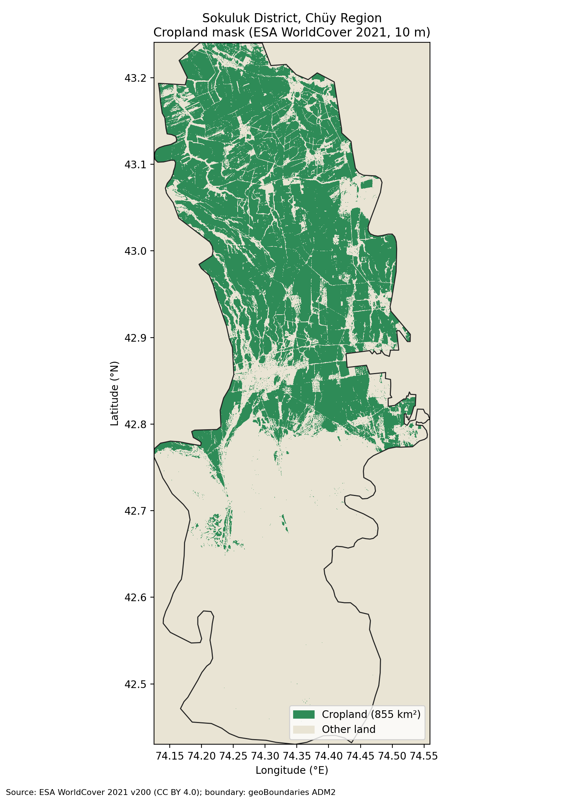

Reproduce the map and statistics: `python3 scripts/make_day1_map.py`

### Data sources (Day 1)
| Data | Source | License |
|---|---|---|
| Admin boundary | geoBoundaries ADM2 (KGZ) | CC BY 4.0 |
| Land cover | ESA WorldCover 2021 v200, 10 m | CC BY 4.0 |

### Limitations
- WorldCover class 40 means *cropland*, not *wheat*, and not necessarily *irrigated*. Crop type is unknown.
- It is a single-year (2021) snapshot; fields change with rotation and abandonment. Overall accuracy is
  roughly 75–80% globally and lower for small fields; edges between fields, orchards and grassland are noisy.
- The geoBoundaries polygon is generalized (administrative, not survey-grade); the mask is clipped to it.
- The raster stores `nodata = 0`, which is the same value as "other land". Re-write the file without a
  nodata value (or use 255) before using it in tools that honour nodata.
- No water-stress label exists yet. Defining how stress is measured (e.g. soil-moisture anomaly, NDVI
  anomaly, evapotranspiration deficit) is the next step, before any model training.

### Next
Collect ERA5-Land weather and soil-water data and SoilGrids soil properties for Sokuluk; decide the water-stress definition.

---

## Day 2 — Historical weather for Sokuluk

**Data:** ERA5-Land hourly reanalysis (Copernicus Climate Data Store, ECMWF), ~9 km grid, downloaded for the box 42.4–43.3 °N, 74.0–74.7 °E.
**Period:** 2 Jan 2018 – 31 Dec 2024 (**2,556 days, no gaps, no missing values**; 1 Jan 2018 is dropped because the first local day is incomplete).
**Output:** `data/processed/sokuluk_weather_daily.csv`

| Column | Meaning | Unit |
|---|---|---|
| `date` | local day, Kyrgyzstan time (UTC+6) | |
| `temperature_2m_c` / `_min_c` / `_max_c` | 2 m air temperature: daily mean / min / max of hourly values | °C |
| `precipitation_mm` | daily total precipitation | mm/day |
| `soil_moisture_l1_m3m3` / `_l2_m3m3` | volumetric soil water, layer 1 (0–7 cm) and layer 2 (7–28 cm), daily mean | m³/m³ |

### Processing (`scripts/download_era5land.py`, `scripts/process_era5land.py`)
1. One CDS request per month (a full year exceeds the request-size limit); 2 m temperature, total precipitation, soil water layers 1–2. 84 monthly files, ~36 MB in `data/raw/era5land/` (not in git).
2. K → °C; m → mm. ERA5-Land precipitation is an accumulation that resets at 00 UTC, so it is converted to hourly amounts (negatives clipped to 0) and summed per local day.
3. The 36 grid cells that contain cropland are averaged **weighted by the cropland area in each cell** (from the Day 1 mask, 855 km² in total), so the series describes the weather over the farmland, not the mountains.
4. A day is kept only if all 24 hours are present. Checked: no missing values, no date gaps.

### First look (`scripts/plot_weather.py`)
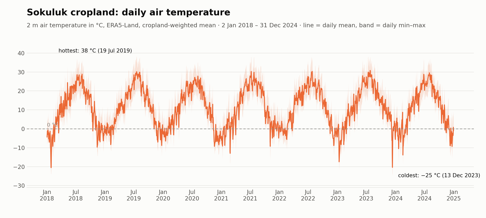
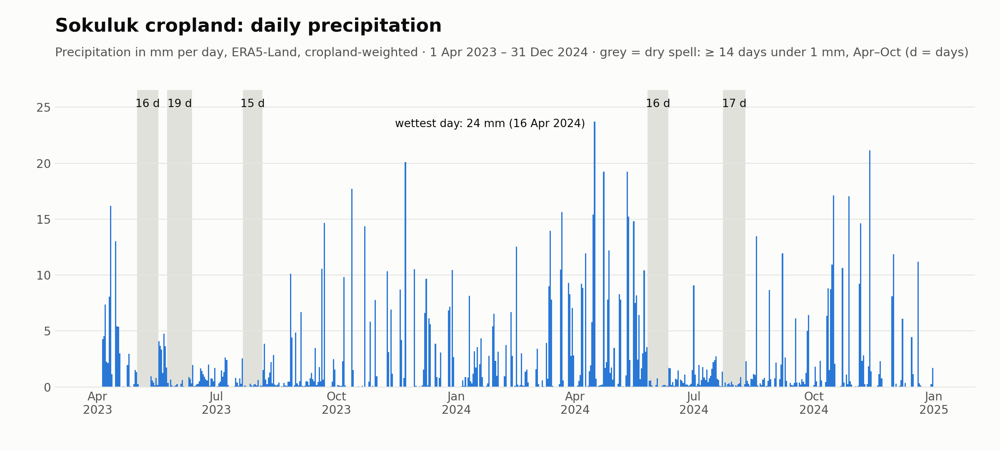

| Year | Mean temp °C | Days max ≥ 35 °C | Precipitation, year (mm) | Precipitation, Apr–Oct (mm) |
|---|---|---|---|---|
| 2018 | 10.3 | 7 | 642 | 323 |
| 2019 | 11.5 | 21 | 703 | 418 |
| 2020 | 10.4 | 1 | 595 | 389 |
| 2021 | 11.1 | 9 | 567 | **253** |
| 2022 | 11.7 | 9 | 746 | 342 |
| 2023 | 11.9 | 18 | 592 | 290 |
| 2024 | 10.9 | 7 | 756 | 467 |

- Strong seasonal cycle: daily mean from about −20 °C in winter to about 31 °C in July; hottest day 38 °C (19 Jul 2019), coldest daily minimum −25 °C (13 Dec 2023). 72 days reached 35 °C, most of them in 2019 (21) and 2023 (18).
- **2021 was the driest growing season** (253 mm Apr–Oct), **2024 the wettest** (467 mm); 2019 and 2023 were the hottest.
- 16 **dry spells** (≥ 14 days under 1 mm, Apr–Oct) in `reports/dry_spells.csv`; the longest is 36 days, 9 Jul – 13 Aug 2019. Every year except 2021 has at least one in May–Aug.

### What this data can and cannot tell us about water stress
**Can:** show when it was hot and dry, how long dry spells lasted, and roughly how wet the top soil was — the weather side of water stress, at daily resolution and over seven seasons.

**Cannot:**
- Tell whether a *specific field* needs water. ERA5-Land cells are ~9 km wide, so one number covers many fields, crops and irrigation schedules.
- See **irrigation**. Much of Chüy's cropland is irrigated from canals, so a dry spell does not mean dry fields. This is the biggest gap.
- Measure the plant itself. Crop stress needs satellite vegetation data (Day 3, Sentinel-2 NDVI) and a way to validate it.
- Be treated as station-quality. It is a model product: temperature mixes valley and foothill elevations. Precipitation looks **high**: the 7-year mean is ~658 mm/year (567–756), which is more than I would expect for the Chüy plain, so ERA5-Land probably over-estimates rain here. Use it for *relative* comparisons (wetter vs drier years and spells) and check it against weather-station data before using absolute amounts.

### Next
Day 3: Sentinel-2 vegetation (NDVI) over the cropland mask (`scripts/ndvi_sentinel2.py`, in progress). Later: align weather, vegetation and cropland in space and time, then define a defensible water-stress indicator before any model.

---

## Day 3 — Satellite vegetation (NDVI) over the cropland

**What NDVI is:** NDVI = (NIR − Red) / (NIR + Red) = (B08 − B04) / (B08 + B04) from Sentinel-2 surface reflectance. Healthy leaves absorb red light and reflect near-infrared, so higher NDVI = greener, denser vegetation (≈ 0.2–0.5 sparse/young crops, 0.5–0.9 dense healthy crops, ≈ 0 bare or harvested soil, < 0 water/cloud/snow). **It measures greenness, not water stress.**

**Source:** Sentinel-2 L2A (ESA / Copernicus), Cloud-Optimized GeoTIFFs on AWS via the open Earth Search STAC catalogue (no account needed). Tiles 43TDG + 43TDH cover Sokuluk.

### 1. One clear peak-season map → `data/processed/sokuluk_ndvi.tif`
*(39 MB, so it is **not stored in git**: regenerate it with `python3 scripts/ndvi_map.py`, about 5 minutes; `sokuluk_ndvi_meta.json` next to it is committed.)*
| | |
|---|---|
| Image date | **27 May 2024** (scenes `S2B_43TDH_20240527_1`, `S2B_43TDG_20240527_0`; scene cloud 0.3 % and 2.3 %) |
| Why this date | highest greenness of the 2023–2024 series (mean NDVI 0.65) and 100 % of the cropland clear |
| Grid | EPSG:32643 (UTM 43N), 10 m, 3,668 × 9,135 px, float32, nodata −9999 |
| Result | 855 km² of cropland, mean NDVI **0.65**, median 0.71, 10th–90th percentile 0.28–0.91 |

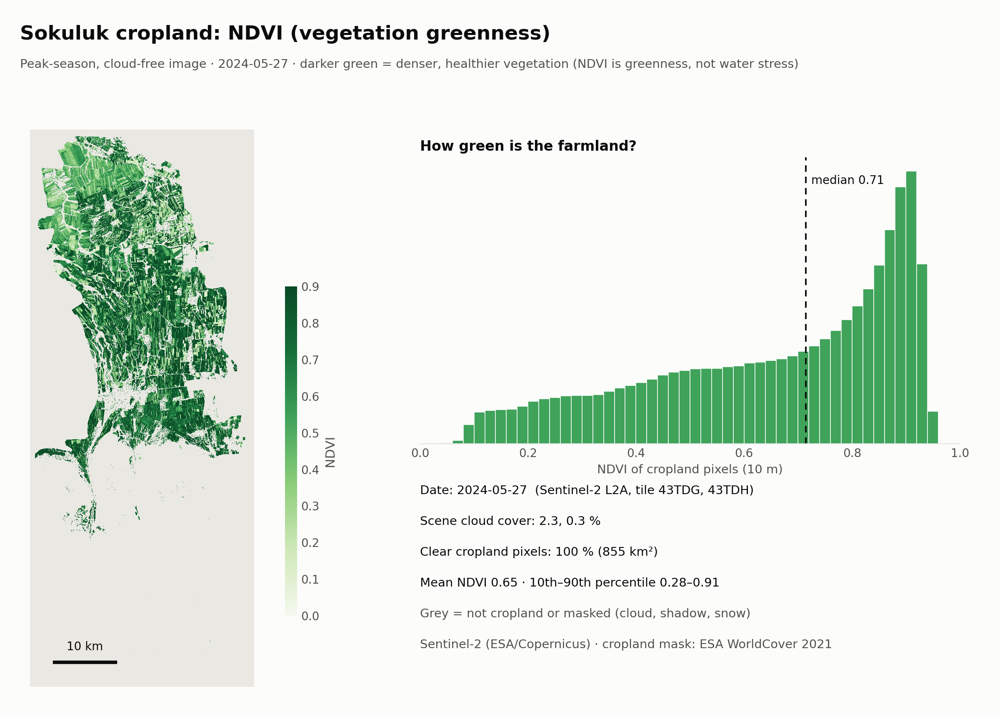

Processing (`scripts/ndvi_map.py`, `scripts/plot_ndvi.py`): read B04, B08 and the scene-classification layer (SCL) for both tiles → reflectance = (DN + offset)/10000 → NDVI → keep only SCL "vegetation"/"bare soil" pixels, with cloud, shadow, cirrus and snow classes dilated by 2 px → keep only cropland pixels (Day 1 WorldCover mask, resampled to the grid by nearest neighbour). The mask file declares `nodata = 0`, which silently breaks resampling, so it is read as a plain array.

### 2. NDVI time series → `data/processed/sokuluk_ndvi_daily.csv`
`scripts/ndvi_sentinel2.py` processes 287 Sentinel-2 scenes (< 40 % cloud, Apr 2023 – Dec 2024) at 80 m (COG overview level) and gives one mean NDVI of clear cropland pixels per date: **121 dates** (68 with ≥ 30 % of the cropland clear). The 10 m map and the 80 m series agree (0.651 vs 0.654 on 27 May 2024).

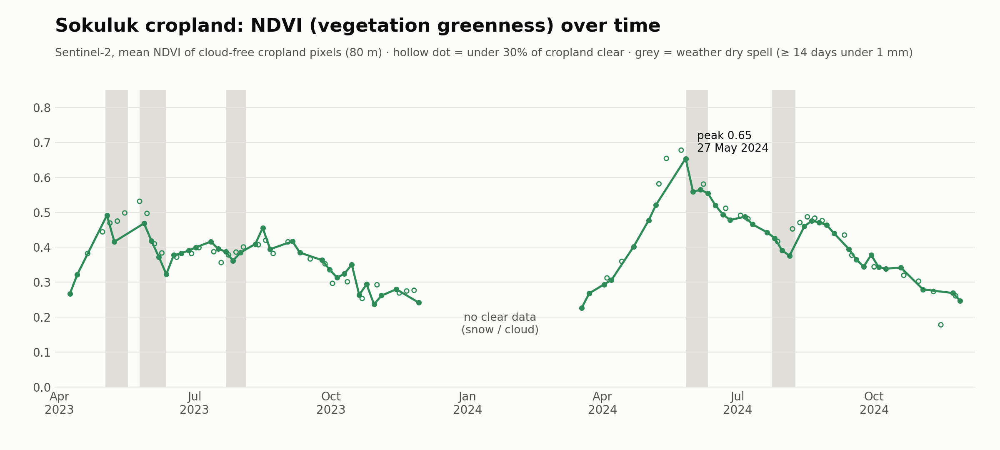

- Clear seasonal cycle: ≈ 0.25 in autumn/winter, rising in spring. **Peak 0.65 on 27 May 2024; the 2023 peak was only 0.49** (3 May 2023). Summer (Jun–Aug) mean NDVI: **0.39 in 2023 vs 0.48 in 2024.**
- That matches the weather (Day 2): 2023 was drier and hotter (Apr–Oct 290 mm vs 467 mm of modelled rain; 18 vs 7 days ≥ 35 °C). It is a **hint, not proof**: crop mix, sowing dates, irrigation and cloud masking also change NDVI.
- **No clear data from December to mid-March** (snow and cloud), shown as a gap, not interpolated.

### Limitations
- NDVI is greenness. A pale field can be ripe wheat or a harvested field, not a stressed one; a green field can still lack water. Water stress needs a time series, weather, and a validation method.
- Mixed pixels at field edges; cloud-mask errors; snow in winter. The 80 m series blurs small fields; the 10 m map is a single date.
- The NDVI raster is in UTM (10 m) while the Day 1 mask is in EPSG:4326; Day 4 puts everything on one grid.
- Sentinel-2 scenes are fetched over a slow connection (~100 KB/s per request), so the code reads many strips in parallel and caches results (`data/raw/sentinel2_ndvi_scenes.jsonl`, not in git).

### Next
Day 4: combine the cropland mask, weather and NDVI into one consistent geospatial dataset (same grid, same dates).

---

## Day 4 — First structured dataset (weather + NDVI + cropland on one grid)

**Output:** `data/processed/sokuluk_grid_daily.csv.gz` — **76,680 rows = 2,556 days (2 Jan 2018 – 31 Dec 2024) × 30 grid cells.** Cell table (centres, cropland area): `data/processed/grid_cells.csv`. Full audit, validation table and coverage summary: [`reports/data_audit.md`](reports/data_audit.md). Built by `scripts/ndvi_by_cell.py` (NDVI per cell, resumable) and `scripts/build_dataset.py`. Source files are never modified.

**The grid:** the three inputs use different grids — cropland mask EPSG:4326 (~8 m), NDVI EPSG:32643 (10 m map, 80 m series), weather 0.1° lat/lon (~9 km). Everything is put on the **weather grid** (ERA5-Land cells, 30 of them hold cropland, 855 km²): each pixel goes to the cell whose centre is nearest. Cell weather is the Day 2 processing done per cell (not district-averaged).

| Column | Meaning |
|---|---|
| `date`, `cell_id`, `latitude`, `longitude` | local day (UTC+6) and cell centre |
| `cropland_km2` | cropland in the cell (weights) |
| `temperature_2m_c` (+ `_min_c`, `_max_c`), `precipitation_mm` | daily weather |
| `soil_moisture_l1_m3m3`, `_l2_m3m3` | ERA5-Land soil water, 0–7 cm and 7–28 cm |
| `ndvi`, `ndvi_valid_frac`, `ndvi_n_pixels`, `ndvi_n_scenes` | mean NDVI of clear cropland pixels in the cell **on days with a satellite observation**, otherwise empty |

**Validation (all pass):** no duplicate (date, cell) rows · no date gaps · no missing weather · values in physical ranges · cropland-weighted cell weather reproduces the Day 2 district series (max difference 0.006) · cell NDVI reproduces the Day 3 district series on all 121 dates (difference 0.0000) · cropland area per cell agrees between the 4326 mask and the 80 m UTM grid (ratio 0.97) · NDVI exists only where a clear observation exists.

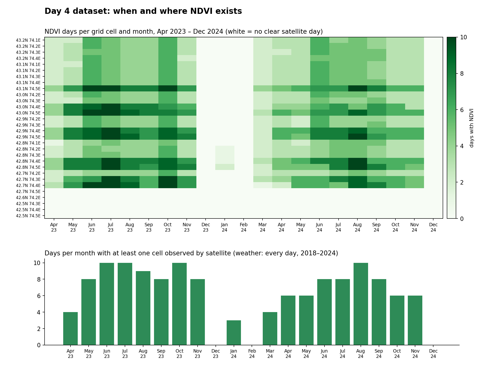

**Coverage and missing values**
- Weather: complete (0 missing of 460,080 values).
- **NDVI: 2,087 rows (2.7 %)**. It exists only for Apr 2023 – Dec 2024 (11 % of cell-days in that window, 132 days with at least one observed cell, ~53 % of cells on an observation day), with **no data in Dec–Feb** (snow, cloud). The eastern and tile-overlap cells are observed more often (up to ~10 days a month) than central cells (2–5). 5 cells (0.1 km²) never get NDVI.
- NDVI is **never interpolated or filled in**. Soil moisture is model data; soil properties (SoilGrids) are not added yet.
- Correction: Day 2 mentioned 36 cells; 6 of them held only trace cropland (< 0.01 km²) and are dropped here (area unchanged).

**What this means for the 3–7-day goal:** weather and NDVI are now aligned by date and cell, but NDVI days are sparse, so Day 5 must decide how to use them (e.g. "latest observation + its age", or train only on observation days). Only ~2 growing seasons have NDVI — extending Sentinel-2 back to 2018 would add training seasons. Cells are ~9 km, so this is a regional, not field-level, dataset, and there is still **no water-stress label** or ground truth.

### Next
Day 5: explore relationships between weather, precipitation and vegetation and set a baseline analysis before any model; define a measurable water-stress indicator.

---

## Day 5 — Exploratory analysis: how does weather relate to NDVI?

**Notebook:** [`notebooks/05_exploratory_analysis.ipynb`](notebooks/05_exploratory_analysis.ipynb) (fully executed). Figures: `reports/figures/eda_*.png`. This is *exploratory*; nothing here proves water stress.

**Data check (Day 4 dataset):** 76,680 records × 15 columns · 2018-01-02 – 2024-12-31 · 30 cells · 0 duplicate (date, cell) rows · weather 0 % missing and in physical ranges · **NDVI present on 2.7 % of rows (10.9 % inside the Apr 2023 – Dec 2024 window)**, 2023: 1,068 and 2024: 1,019 rows.

| | |
|---|---|
| 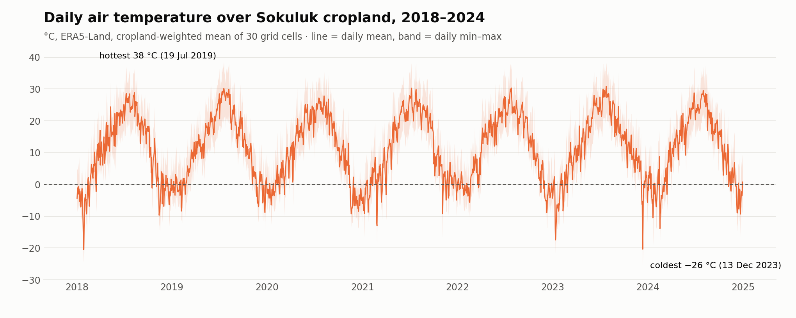 | 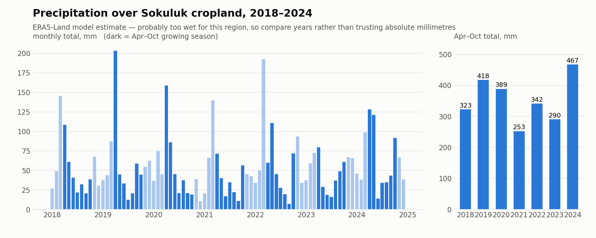 |
| 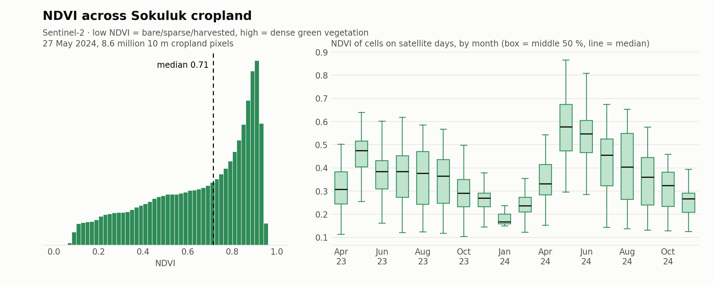 | 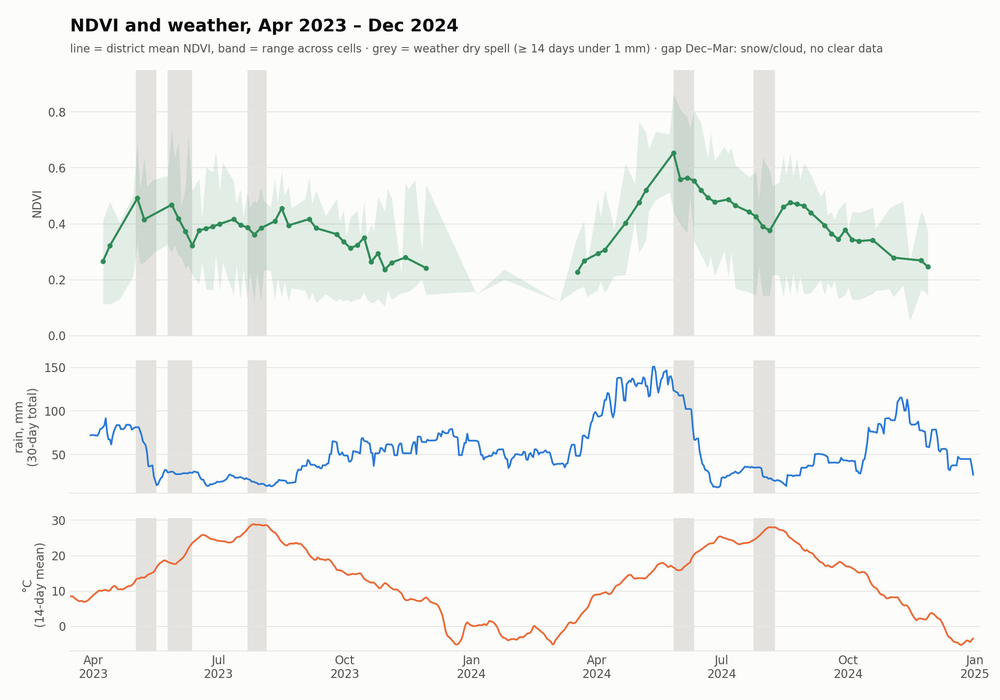 |

Distributions: daily temperature −21 to 31 °C (district mean), cropland rain 0–41 mm/day (annual Apr–Oct totals 253–467 mm), 10 m NDVI on 27 May 2024 has median 0.71 (10th–90th percentile 0.28–0.91).

**How relationships were tested** (three ways, each controlling more): pooled correlation (confounded by the season) → same-day comparison across cells (removes the season, keeps the spatial pattern) → year-over-year change inside each cell (removes season *and* place).

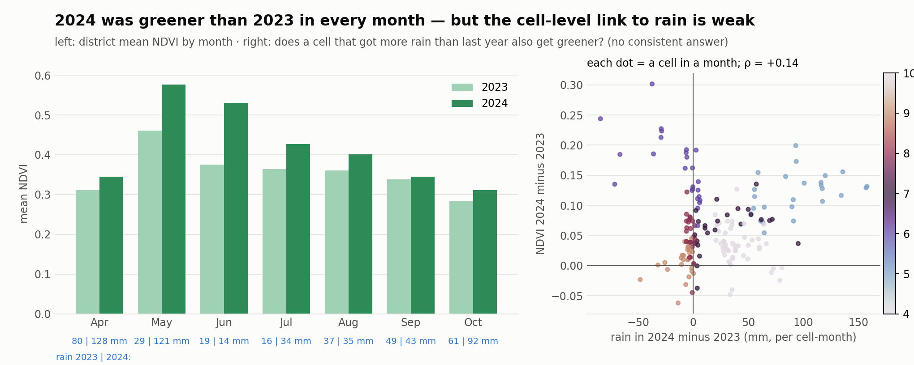

### Three observations
1. **2024 was greener than 2023 in every month Apr–Oct** (district NDVI +0.01 to +0.16, largest in May–June), in a year with far more spring rain (Apr–May ≈ 249 mm vs 108 mm in the model) and fewer hot days. Consistent with moisture mattering, but June's gap is not explained by rain and there are only two years.
2. **Pooled weather–NDVI correlations are weak (|ρ| ≤ 0.22) and mostly seasonal.** Across cells on the same day, wetter/cooler cells are greener (median ρ ≈ +0.3 rain, −0.4 temperature), but cells differ by ~8 °C and 3× in rain (plain vs foothills), so that is a fixed spatial pattern, not a weather effect.
3. **With season and place removed, no consistent relationship remains**: cell-level 2024-minus-2023 change in NDVI vs change in rain ρ = +0.14, vs temperature −0.05, with signs flipping between months. Of the 5 dry spells in the NDVI window only 3 have clear observations before and after, and the NDVI change across them (+0.02, −0.10, +0.02) lies inside the normal 16-day range (−0.09 to +0.09).

### Two data limitations
1. **NDVI is short and sparse:** ~2 growing seasons, 2.7 % of rows, nothing from Dec to mid-March, so "lower than normal" cannot be defined (no multi-year baseline).
2. **The resolution hides what matters:** 9 km weather cells, unknown irrigation/crop type/sowing dates, ERA5 rain that looks too high, and NDVI that also falls when crops ripen — a weather effect cannot be separated from land type or management.

### One question to investigate next
Does NDVI fall below its **own seasonal norm** after hot, dry periods once crop phenology is accounted for? That needs a multi-year NDVI baseline (Sentinel-2 back to 2018) and, ideally, a second stress indicator that does not rely on NDVI (soil-moisture or evaporation deficit).

### Next
Day 6: define a measurable water-stress indicator and check what can serve as a reliable target for model training.

---

## Day 6 — Defining the water-stress target

**Definition:** [`docs/water_stress_target.md`](docs/water_stress_target.md) · **Analysis:** [`notebooks/06_water_stress_target.ipynb`](notebooks/06_water_stress_target.ipynb) · anomaly values: `data/processed/soil_moisture_anomaly_loyo.csv.gz` · figures `reports/figures/target_*.png`.

**Provisional target:** the **soil-moisture anomaly** — ERA5-Land root-zone soil water (7–28 cm now, 28–100 cm planned) as a z-score against the normal for the same cell and time of year (leave-one-year-out baseline), growing season Apr–Oct. *Dry day* = z ≤ −1, *dry event* = ≥ 7 such days, and the forecast label for a later model = "mean z over days t+3 … t+7 ≤ −1". It is an indicator of agricultural drought conditions, **not** proof that a field needs irrigation, and a field is never called stressed from low NDVI alone.

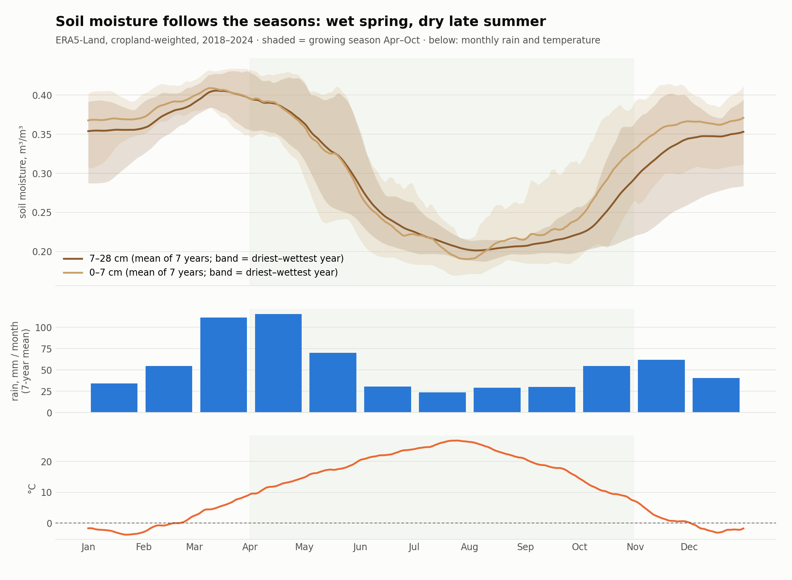
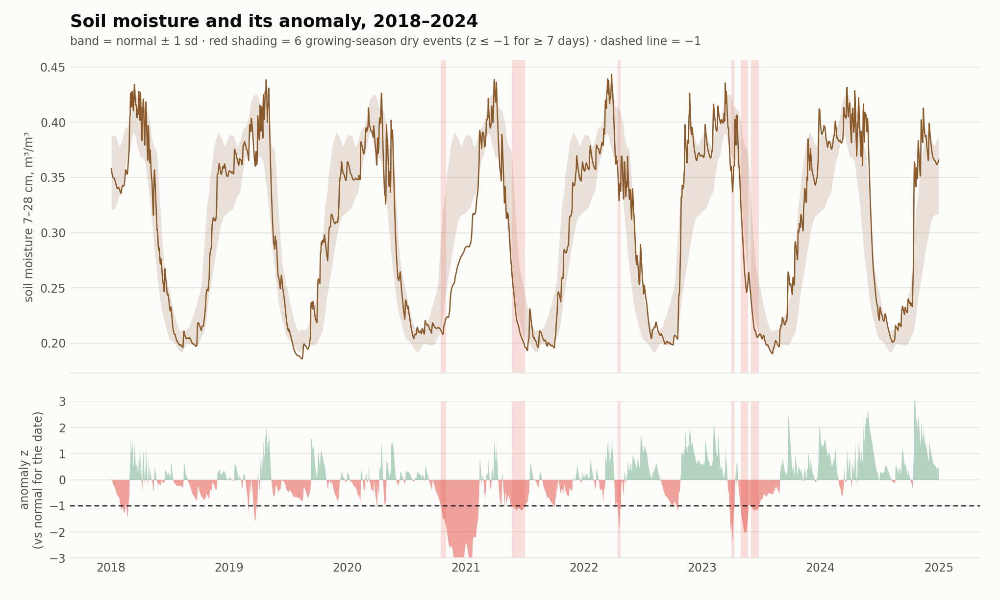

**What the data shows**
- Soil moisture has a strong seasonal cycle (0.40 m³/m³ in March, 0.21 in July–August), so only an anomaly for the date is meaningful.
- The anomaly flags **2021 and 2023 as dry and 2024 as wet** (mean growing-season z −0.50, −0.41, +0.80), matching the Day 2 rain totals; 6 dry events in 7 years; the forecast label is positive on **13.2 %** of growing-season cell-days.
- **A trivial persistence rule already reaches AUC 0.93**, so any model must beat that.
- It follows recent rain (ρ = +0.53) and moves with NDVI between 2023 and 2024 at district level (r = +0.73, 7 months) — but the cell-level link (pooled ρ = +0.59) **vanishes within a month** (median ρ = −0.11), so it has not been shown to explain differences between cells.

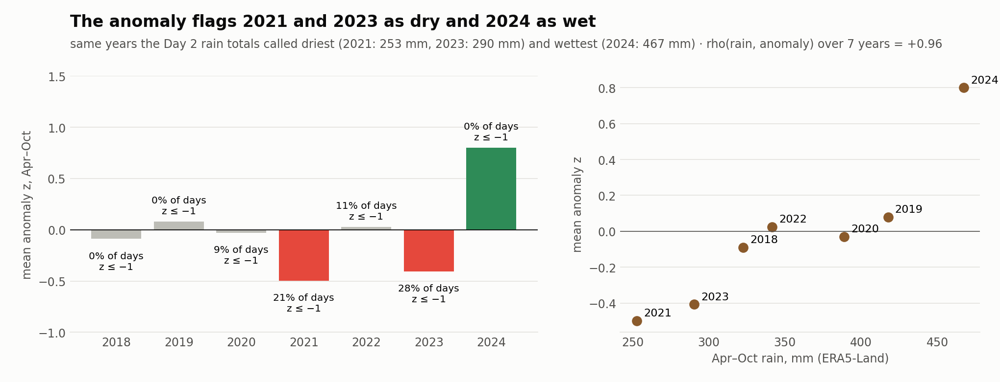
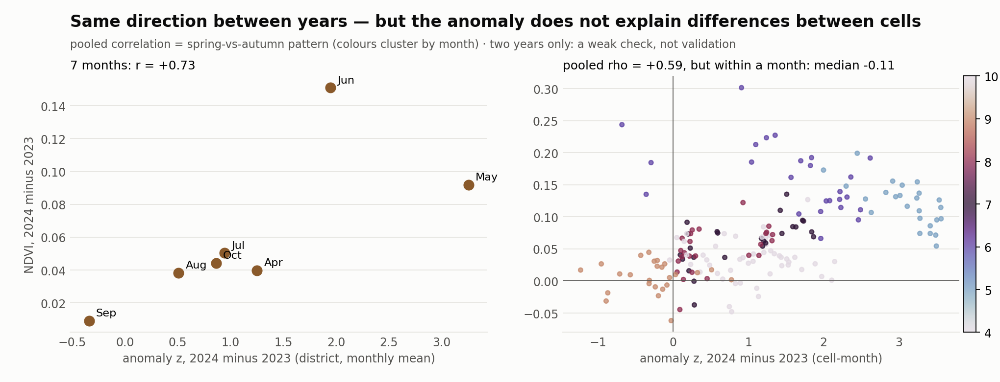

**Main limitations:** the target is produced by a model driven by the same rain and temperature we would use as predictors (**not independent**); ~9 km cells and no field-level truth; irrigation is invisible; the 7–28 cm layer is shallow; short 7-year baseline. The document lists the **independent observations** needed to validate it (satellite soil moisture, evapotranspiration, a multi-year NDVI baseline, station and agronomic records) and the rules for using it in modelling.

## Day 7 — Leakage-safe feature dataset and evaluation protocol

**Goal:** a reproducible dataset for forecasting "unusually dry soil 3–7 days ahead", with a chronological evaluation fixed *before* modelling.

- **Run:** `python3 scripts/build_features.py` → `data/processed/water_stress_features.parquet` (44,940 rows = 30 cells × 214 April–October dates × 7 years, 28 columns), `water_stress_feature_definitions.csv` (observation window of every feature), `water_stress_splits.csv`, `soil_moisture_normal_train2018_2022.csv`, `reports/feature_dataset_quality.json`. Audit: [`notebooks/07_feature_dataset.ipynb`](notebooks/07_feature_dataset.ipynb). Protocol: [`docs/evaluation_protocol.md`](docs/evaluation_protocol.md).
- **Day 6 is reproducible** (max difference 0.0005) — **but it leaked:** its leave-one-year-out normal uses future years. The anomaly is now computed from the training years 2018–2022 only; the pooled persistence AUC drops from 0.927 to **0.912**.
- **Six automated leakage tests pass** (truncating all data after t changes no feature; changing 2023/2024 soil moisture changes no training row; NDVI is 2–21 days old and never from the future; label window is t+3…t+7; splits are chronological; persistence uses only today's anomaly).
- **Splits:** train 2018–2022, validation 2023, test 2024. Rule fixed in advance: ≥ 200 positive cell-days and ≥ 3 independent episodes. **2023 passes; 2024 does not** (114 positives, 1 episode), so 2024 is descriptive only and the split was not changed.
- **Persistence baseline (to beat on Day 8):** validation 2023 AUC **0.939** (0.89–0.97), F1 0.79; 2024 AUC 0.961 but not reliable.
- **Gaps:** NDVI exists only from April 2023, so it is missing for all training rows and must not be a first-model feature; the target is still model-made (see Day 6).

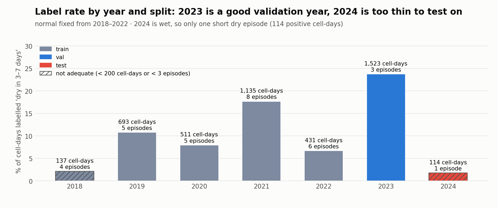
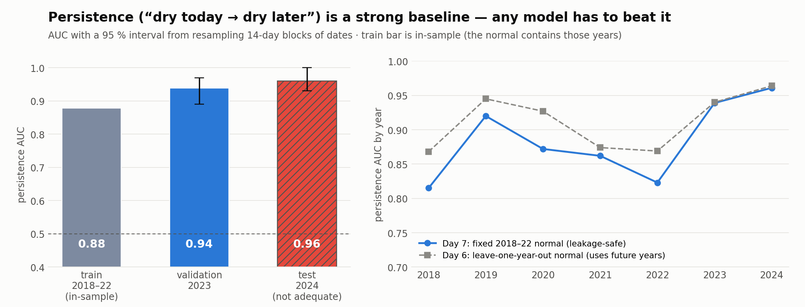

### Next
Day 8: train a simple baseline model on weather and soil-moisture history (no NDVI) and test whether it beats persistence on 2023. Open: ERA5-Land layer 3 and Sentinel-2 NDVI back to 2018.
